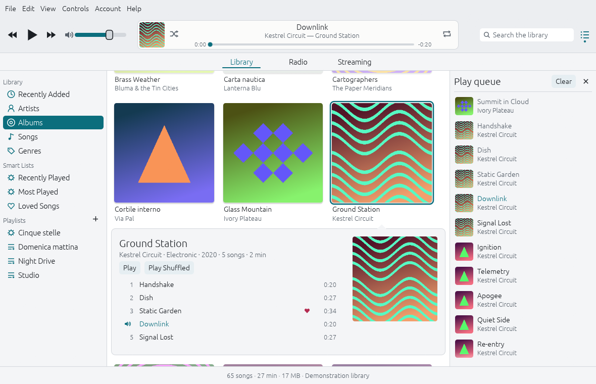
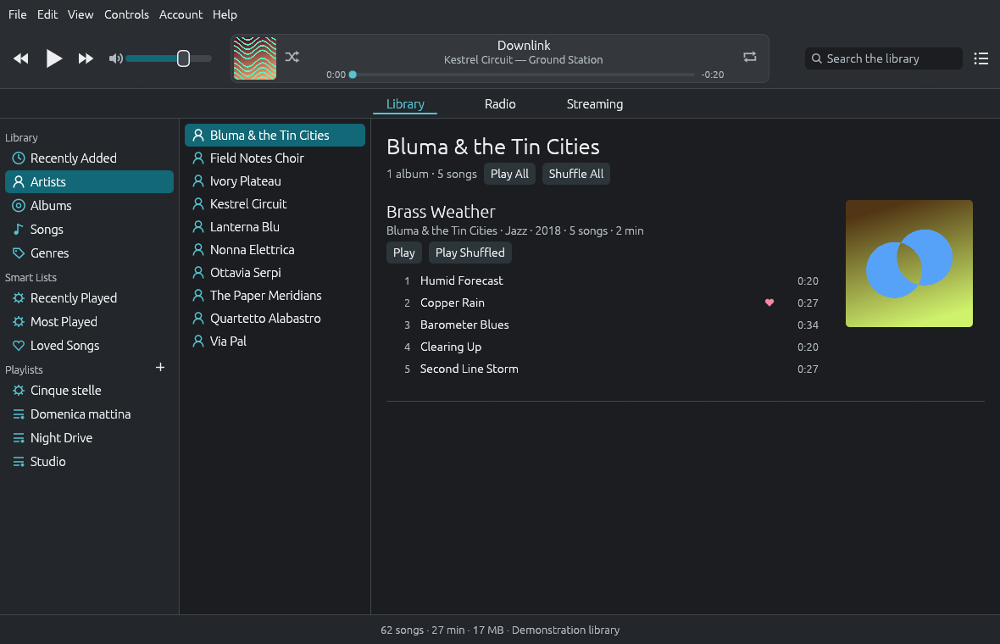
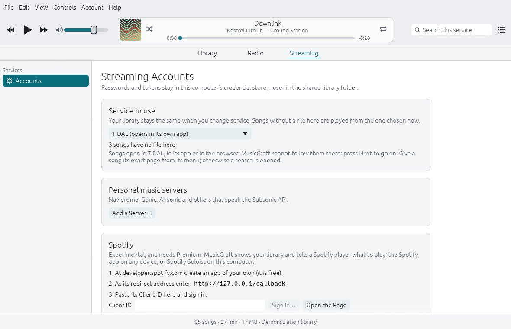

<p align="center"></p>

# MusicCraft

A music library and player that stays the same while the place your music plays from changes: your
files, your music servers, internet radio, or the streaming service you use now. A native desktop app in Rust, for Windows, macOS and Linux. MIT OR Apache-2.0.

Music and library live together in **one folder that you choose**, by default `MusicCraft` inside the
system's music folder. Put it in OneDrive, Google Drive, Dropbox or Syncthing and several computers share
it: songs, play counts, ratings and playlists are merged, not overwritten.







> **Status:** 1.0, the first release. Spotify is built from its public documentation and tested against a
> local stand-in, not against the live service. The rest of this page says what else is missing.

MusicCraft is an independent community project in the style of the Craft apps. It is not an official Craft
app, and it is not affiliated with ArtCraft, Apple or Spotify. Other projects use the same name.

## What it does

- **Library**: recently added, artists, albums, songs, genres, search, column browser, love, 0–5 stars, play
  counts, tag editing written into the files.
- **A stable library**: it also holds songs you have no file of. Those play from the *service in use*, and
  change nothing but their source when you choose another. A song keeps its love, stars, play count and
  playlists through that, and takes its file when one arrives.
  - On a **music server** each song is found by its recording code, or by title, artist, album and length;
    only a clear match is taken, and you can choose by hand.
  - For **TIDAL, Apple Music, Deezer, YouTube Music, Amazon Music and Spotify** the song opens in the
    service's own app or web player: its page if you gave it, otherwise a search.
  - Add songs from a service, by hand, or from a CSV list with title and artist columns.
- **Import**: the library iTunes or Apple Music export as XML (*File › Library › Export Library…*), with files,
  stars, love, play counts, dates and playlists. Importing again adds nothing twice.
- **Playlists**: ordinary and smart ones (rules with all/any, limit and order), M3U/M3U8 and PLS in, M3U8 out.
- **Shared folder**: each computer writes only its own catalogue files
  ([format](docs/library-format.md)). Songs that are still only in the cloud are listed without downloading
  them, and downloaded when played.
- **Playing**: play queue, shuffle, repeat, the next song prepared ahead, a compact player.
- **Formats**: MP3, AAC and ALAC (M4A), FLAC, Ogg Vorbis, WAV, AIFF, CAF.
- **Music servers** with the Subsonic or OpenSubsonic API (Navidrome, Gonic, Airsonic and others): albums,
  playlists, search, streaming.
- **Internet radio**: your stations, and the Radio Browser directory.
- **Spotify (experimental)**: saved songs, playlists and search, played on any Spotify Connect device, or on
  this computer through Spotify Soloist if you install it.
- English and Italian; light, dark or the system's theme; keyboard use and an accessibility tree.

## What it does not do

- **TIDAL, Apple Music, Deezer, YouTube Music and Amazon Music** are not signed in to, searched or played
  inside MusicCraft. It opens them and cannot see when a song ends: *Next* goes on with the queue. TIDAL, for
  one, allows playing only in its own player, and forbids combining it with other services.
- **Spotify** needs Premium and a free Client ID of your own (its Development Mode allows five people per
  Client ID). Its developer policy restricts products that integrate other services' streams, so it is
  never the service in use unless you choose it. MusicCraft does not decode, record or download Spotify's audio. Spotify lists only the
  contents of playlists you own or work on.
- No Opus, WMA, APE or DSD, no HE-AAC at its full bandwidth, no equalizer, no CD ripping or burning, no phone
  sync, no podcasts, no lyrics.
- It does not read other programs' databases, only the library they export. Films, podcasts, audiobooks and
  protected files are left out or added without the file; smart playlists become ordinary ones.
- No web build and no MCP server yet; the command line runs every command of the engine.
- Known problem: the window may rarely stop at start while drawing (seen once in some forty starts on one
  computer with two graphics cards; egui issues [8450](https://github.com/emilk/egui/issues/8450) and
  [8265](https://github.com/emilk/egui/issues/8265) describe the same message).
- Screen readers were not tried. Tests drive the table and the dialogs through the accessibility tree.

## Install

Each [release](https://github.com/mmazzieri/musiccraft/releases) has these files, with their checksums in
`SHA256SUMS.txt`:

| System | File |
|---|---|
| Windows 10 and 11, x64 | `musiccraft-<version>-windows-x64.msi` or `-windows-x64-portable.zip` |
| macOS 11 or newer, Intel and Apple silicon | `musiccraft-<version>-macos-universal.dmg` |
| Debian, Ubuntu and derivatives | `musiccraft-<version>-linux-<arch>.deb` |
| Fedora, openSUSE, RHEL | `musiccraft-<version>-linux-<arch>.rpm` |
| Any Linux with glibc 2.35 or newer | `musiccraft-<version>-linux-<arch>.tar.gz` |

The files are not signed yet. Windows may ask for a confirmation the first time. On macOS open the app once,
close the warning, then choose **System Settings › Privacy & Security › Open Anyway**.

## Build

Rust 1.95 or newer; on Linux also the ALSA headers (`libasound2-dev` or `alsa-lib-devel`).

```sh
cargo run --release                     # the app
cargo run --release -- --demo           # with a demonstration library
cargo run -p musiccraft-cli -- --help   # without a window
cargo xtask ci                          # fmt, clippy, tests
```

## Documents

[Library format](docs/library-format.md) · [Privacy](PRIVACY.md) · [Security](SECURITY.md) ·
[Contributing](CONTRIBUTING.md) · [Attribution](ATTRIBUTION.md) · [Feature names](docs/feature-names.md)

## License

MIT OR Apache-2.0, at your option.
